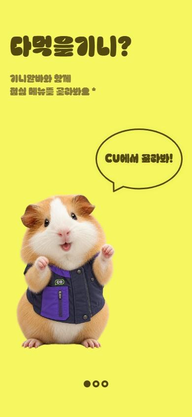
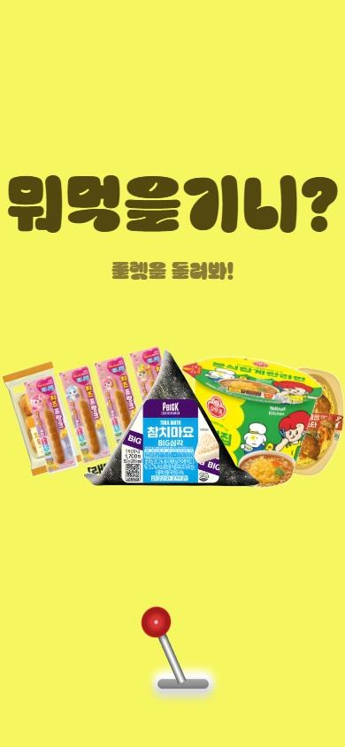
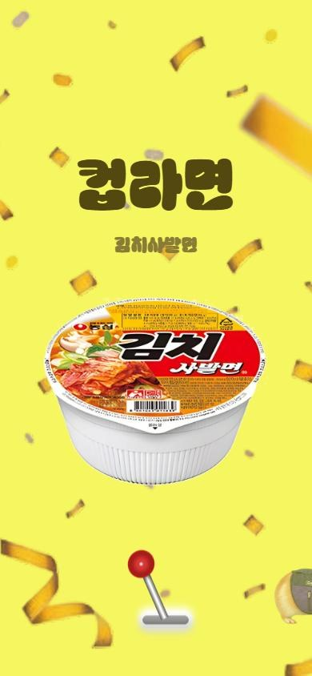

# 다먹을기니? (guinea-menu)

한신대학교 장준하통일관 CU(한신대60주년관점)에서 오늘 뭐 먹을지 골라 주는 모바일 룰렛 웹앱입니다.
기니알바가 손잡이를 당기면 CU 간편식 443종이 가로 슬롯머신처럼 돌아가고, 멈춘 메뉴를 알려 줍니다.

**👉 바로 써 보기: https://guinea-menu.pages.dev**

| 시작 | 온보딩 | 룰렛 | 돌리는 중 | 결과 |
|:---:|:---:|:---:|:---:|:---:|
|  |  |  |  |  |

## 기능

- **시작 화면**: 파스텔 톤 원형 배경이 천천히 떠다니며 색이 바뀝니다.
- **온보딩 3단계**: 기니알바가 등장한 뒤 말풍선이 말하듯 한 글자씩 나타납니다. 탭하면 다음, 오른쪽으로 밀면 이전 단계.
- **가로 룰렛**: 화면에 5개 상품. 대기 중에는 2초마다 한 칸씩 왼쪽에서 오른쪽으로 넘어갑니다.
- **머신 손잡이**: 누르면 "철컥", 머리를 오른쪽으로 끝까지 당기면 "철커덕" 소리와 함께 4초 동안 돌아갑니다. 탭만 해도 당겨집니다.
- **돌리는 중**: 기니알바가 왼쪽에서 걸어 들어와 기다리다가, 결과가 나오면 오른쪽으로 걸어 나갑니다.
- **결과**: 컨페티가 터져 천천히 흘러내리고, 큰 카테고리(예: 도시락)와 상세 상품명을 보여 줍니다. 손잡이를 다시 당기면 반복합니다.
- 화면 비율과 상관없이 Figma 디자인(390×844)을 비율 그대로 맞춥니다. 검색엔진 수집은 막아 두었습니다(`noindex`).

## 구조

```
app/                   배포되는 웹앱 (정적 파일, 빌드 도구 없음)
  index.html
  css/app.css          Figma 수치 그대로의 레이아웃과 애니메이션
  js/app.js            화면 흐름, 룰렛, 손잡이, 효과음(Web Audio 합성)
  js/menu.js           상품 데이터 (build_app.py가 생성)
  img/                 배경을 지운 상품 이미지 800×800 WebP
  assets/              Figma 에셋, 폰트(롯데리아 촵땡겨체), 기니피그 이미지
  _headers             Cloudflare Pages 응답 헤더 (noindex)
cu_products.py         CU 공식 홈페이지 상품 목록 수집
make_checklist.py      품목별 분류(샌드위치·햄버거·핫바·김밥·컵라면·도시락…)
process_images.py      이미지 4배 업스케일(Real-ESRGAN) + 배경 제거 + 크기 통일
build_app.py           상품 데이터·이미지를 app/에 넣기
serve.py               로컬 미리보기 서버
cu-guinea-pig-photo-assets/  기니알바 원본 이미지
```

## 로컬에서 실행

```bash
python serve.py
```

http://localhost:8765 에서 열립니다. 같은 Wi‑Fi의 휴대폰에서는 `http://<PC IP>:8765` 로 볼 수 있습니다.

## 상품 데이터·이미지 다시 만들기

```bash
python cu_products.py data/cu_products_raw.csv
python make_checklist.py data/cu_products_raw.csv 한신대60주년관점_재고확인표.csv
# 이미지 처리에는 PyTorch, spandrel, onnxruntime과 Real-ESRGAN·BiRefNet 가중치(models/)가 필요합니다
python process_images.py upscale data/raw_images data/upscaled
python process_images.py cutout data/upscaled data/cutout
python build_app.py
```

CU 원본 이미지 중 일부는 확장자만 `.jpg`인 투명 PNG입니다. 이런 이미지는 원본 투명도를 그대로 업스케일해 쓰고, 흰 배경 JPEG만 배경을 분리합니다.

## 배포

Cloudflare Pages 프로젝트 `guinea-menu`에 `app/` 폴더를 올립니다.

```bash
npx wrangler pages deploy app --project-name guinea-menu --branch main
```

## 참고

- 상품명·이미지는 CU(BGF리테일) 공식 홈페이지의 전국 공통 상품 정보입니다. 실제 매장 재고와 다를 수 있습니다.
- 이 저장소는 개인 학습용 비공식 프로젝트이며 CU·BGF리테일과 관련이 없습니다. 상품 이미지의 권리는 각 권리자에게 있습니다.
- 폰트: [롯데리아 촵땡겨체](https://noonnu.cc/font_page/1100) (무료 상업 이용 가능)
