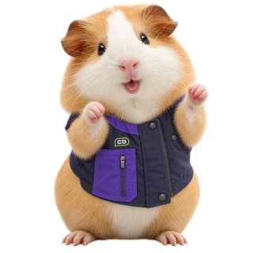
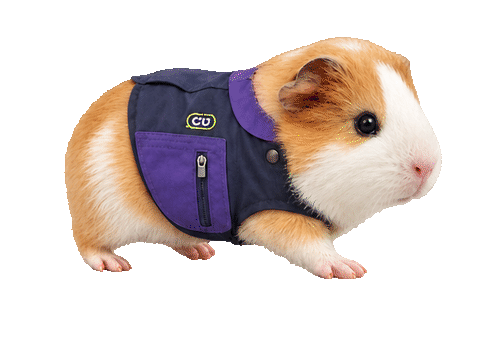

# 실제 기니피그 사진 기반 CU 알바생 에셋

사용자가 첨부한 기니피그 사진과 CU 유니폼 사진을 입력으로 사용하여 내장 이미지 생성 도구로 제작했습니다. 원본의 얼굴·털무늬·사진 질감을 살린 생성 이미지이며, 새로운 자세의 픽셀이 원본 사진과 동일한 것은 아닙니다. Blender 모델과는 별개로 새로 제작한 파일입니다.

- `point-up.png`: 앞발을 들고 위를 바라보는 상태
- `success.png`: 양 앞발을 들고 기뻐하는 상태
- `failure.png`: 몸을 낮추고 고개를 숙인 우울한 상태
- `loading-walk.gif`: 오른쪽을 향해 네 발로 제자리걸음. 480×352px, 6프레임, 0.84초 무한 반복, 투명 배경.
- `loading-walk.webp`: 같은 걷기 모션의 WebP 버전. 반투명 털 경계를 보존하며 GIF보다 파일이 작습니다.
- `loading-still.png` / `.webp`: 걷기 모션의 정지 대체 이미지.
- `*-320.webp`, `*-640.webp`: 반응형 웹용 정지 이미지. 원본 PNG는 1254×1254px입니다.

권장 표시 크기: 정지 이미지 160–320 CSS px, 걷기 160–240 CSS px. 정지 3종에는 애니메이션이 없습니다. GIF는 1비트 투명도 한계 때문에 미세한 털의 반투명 경계는 WebP보다 거칠 수 있습니다. 걷기는 생성한 6개 포즈를 연결한 프레임 애니메이션입니다.

```html


<picture>
  <source media="(prefers-reduced-motion: reduce)" srcset="loading-still.webp">
  
</picture>
```

`prompts.json`에 최종 이미지 생성 프롬프트를 기록했습니다. PNG 알파 채널과 GIF 프레임 수·반복 설정을 검사했습니다.
